# Obsidian Shield

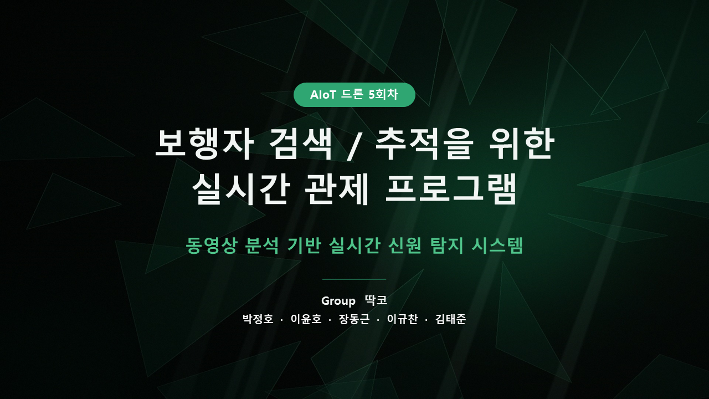

> 드론·CCTV 영상에서 사람을 찾아 얼굴을 대조하고, 실종자·수배자 같은 주의 인물이 발견되면 지도 위에 동선을 그려 알려주는 실시간 관제 시스템

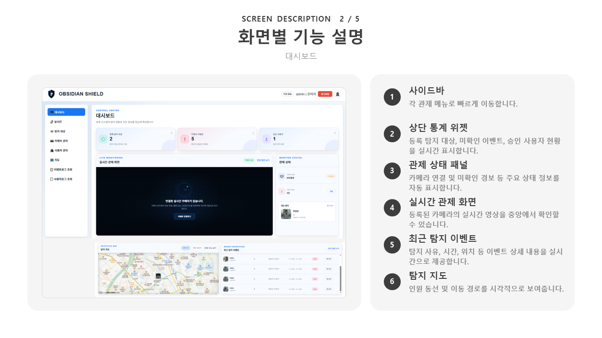

드론과 CCTV 영상에서 **사람을 탐지(YOLO) → 같은 사람을 따라가고(BoT-SORT) → 등록된 얼굴과 비교(InsightFace)** 한다. 등록된 대상과 일치하면 발견 시각·위치·캡처 이미지를 이벤트 로그로 저장하고, 관제 화면에 실시간으로 알린다. 탐지된 위치는 카카오맵에 표시해 대상의 이동 경로를 한눈에 볼 수 있다.

이 프로젝트는 DW 아카데미 AIoT 드론 5회차의 팀 프로젝트(1차, 팀 **딱코**)이다. 2026.06.25 ~ 2026.07.24 동안 진행했다.

> 위 화면은 기획 단계의 와이어프레임·화면 설명 슬라이드에서 가져왔다. 슬라이드에 쓰인 영상은 시연용 샘플이다.

## 목차
- [🎯 왜 만들었나](#-왜-만들었나)
- [⚡ 주요 기능](#-주요-기능)
- [🆚 상용 솔루션과의 차이](#-상용-솔루션과의-차이)
- [📸 화면](#-화면)
- [🤖 AI 모델 활용 방식](#-ai-모델-활용-방식)
- [🔧 기술 스택](#-기술-스택)
- [🧩 시스템 구성](#-시스템-구성)
- [📁 폴더 구조](#-폴더-구조)
- [🚀 로컬에서 실행하기](#-로컬에서-실행하기)
- [👥 팀](#-팀)
- [🗓 진행 과정](#-진행-과정)
- [🚧 알려진 한계와 개선 방향](#-알려진-한계와-개선-방향)

## 🎯 왜 만들었나

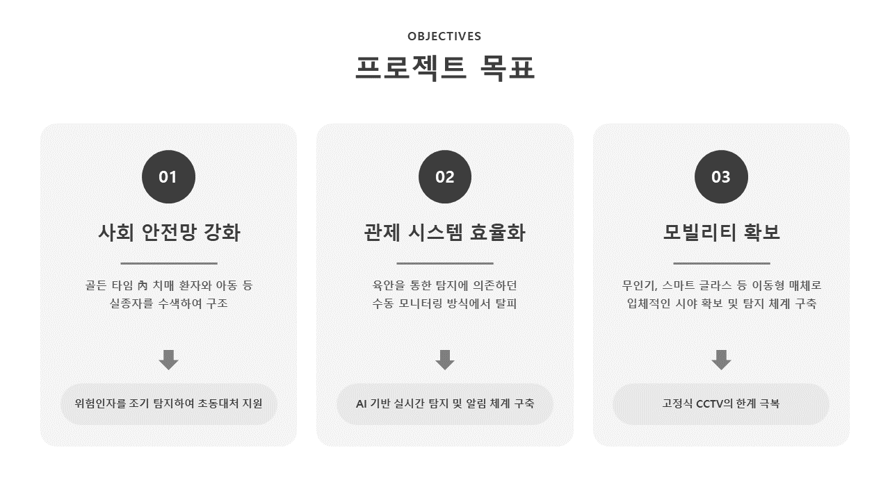

- **수색의 한계**: 모든 보행자를 검문할 수 없어, 지금의 수색은 목격자 신고에 기대고 있다.
- **수동 관제의 한계**: 요원 한 명이 너무 많은 모니터를 보게 되어 모니터링 공백이 생긴다.
- **그래서**: 골든 타임 안에 치매 환자·아동 같은 실종자를 찾고, 육안 관제에서 벗어나 AI가 탐지하고 알리는 체계를 만든다. 드론 같은 이동형 매체로 고정식 CCTV의 사각지대도 줄인다.

## ⚡ 주요 기능

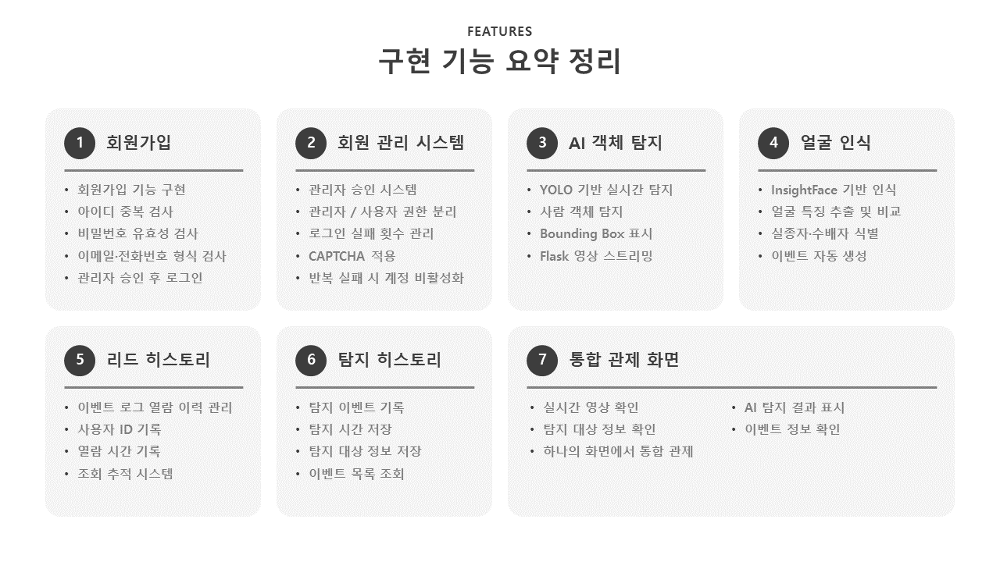

### 회원 서비스
- 회원가입: 아이디·이메일 중복 확인, 비밀번호 8자 이상·특수문자 검사, 전화번호·이메일 형식 검사
- **관리자 승인 후 로그인**, 관리자/관제자 권한 분리
- 로그인 **CAPTCHA**, 연속 실패 3회 시 계정 비활성화, 최초 로그인 시 비밀번호 변경

### 관제 서비스
- 카메라(CCTV·드론) 등록·수정·삭제, 상태 확인, 다중 카메라 전환
- Flask 기반 **실시간 영상 스트리밍** 위에 탐지 박스(Bounding Box) 표시
- **탐지 대상 관리**: 실종자·수배자 사진과 정보 등록, 검색·정렬 (여러 장의 얼굴 특징을 평균 내어 저장)

### AI 탐지·식별
- YOLO로 사람만 탐지, BoT-SORT로 카메라별 Track ID 부여
- InsightFace로 얼굴 특징을 뽑아 등록 대상과 비교, 일치하면 이벤트 자동 생성
- 얼굴 인식은 비동기로 처리해 영상 지연을 줄임

### 이벤트·이력
- 발견 시각·위치·캡처 이미지를 담은 **이벤트 로그**, SSE로 새 이벤트 **실시간 알림**
- 읽음 처리(선택·일괄), 미확인 이벤트 관리, 로그 **엑셀 다운로드**
- **사용자 로그**: 누가 어떤 이벤트를 언제 열람했는지 기록

### 지도·대시보드
- 대시보드: 등록 대상·미확인 이벤트·승인 사용자 수, 카메라 연결 상태, 최근 탐지 이벤트
- 카카오맵에 탐지 위치 마커와 사람별 **이동 경로** 표시

## 🆚 상용 솔루션과의 차이

Briefcam, Intellivix, Anduril 같은 상용 솔루션을 분석하고 다음 네 가지를 차별점으로 삼았다.

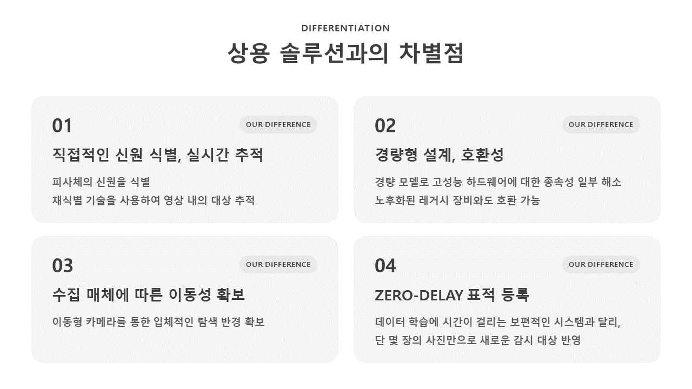

- **직접적인 신원 식별과 실시간 추적**: 재식별 기술로 영상 속 대상을 따라간다.
- **경량형 설계**: 가벼운 모델(YOLOv8n)로 고성능 하드웨어 의존을 줄이고, 오래된 장비와도 맞춘다.
- **이동성**: 드론 같은 이동형 카메라로 탐색 반경을 넓힌다.
- **Zero-delay 표적 등록**: 재학습 없이 사진 몇 장만으로 새 감시 대상을 바로 반영한다.

## 📸 화면

| 로그인 · 회원가입 | 대시보드 |
|---|---|
| 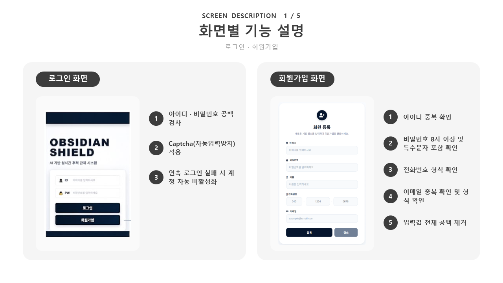 |  |

<details>
<summary>와이어프레임 · 유즈케이스</summary>

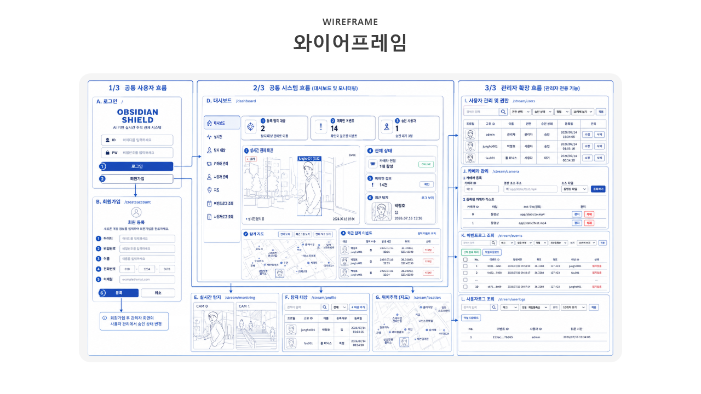

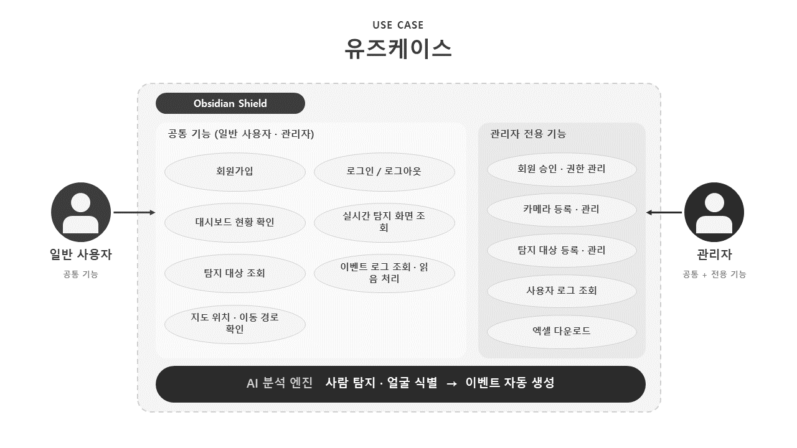

</details>

## 🤖 AI 모델 활용 방식

세 모델 모두 **재학습 없이 사전 학습 가중치를 그대로** 쓰고, 탐지 조건·추적 방식·비교 기준만 프로젝트에 맞게 조정했다.

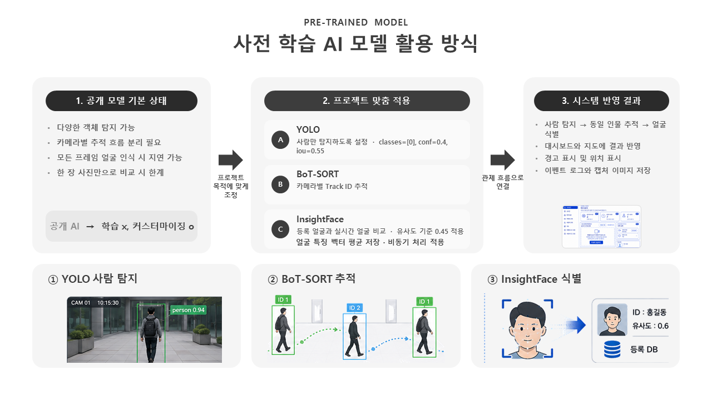

| 단계 | 모델 | 쓰임 | 조정한 점 |
|---|---|---|---|
| ① 탐지 | YOLOv8n | 영상에서 사람 위치 추출 | `classes=[0]`(사람만), `conf=0.4`, `iou=0.55`, `imgsz=640` |
| ② 추적 | BoT-SORT | 같은 사람에게 Track ID 유지 | 카메라별로 추적기를 따로 생성 |
| ③ 식별 | InsightFace (`buffalo_l`) | 얼굴 특징 비교로 대상 식별 | 유사도 0.45 이상이면 같은 대상, 등록 사진 특징은 평균 벡터로 저장 |

```text
영상 입력 → YOLO 사람 탐지 → BoT-SORT 추적 → InsightFace 식별 → 위치 표시 · 경고 · 로그 저장
```

## 🔧 기술 스택

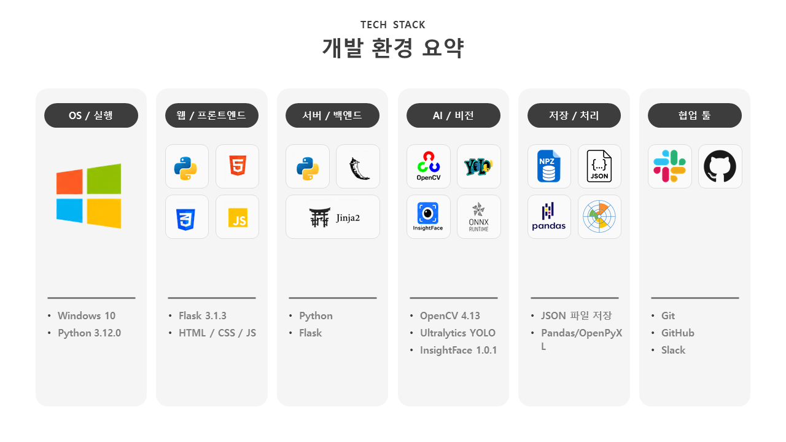

| 영역 | 사용 기술 |
|---|---|
| 실행 환경 | Windows 10, Python 3.12.0 |
| 서버 | Flask 3.1.3, Jinja2 템플릿, SSE |
| 화면 | HTML / CSS / JavaScript, 카카오맵 API |
| AI·영상 | Ultralytics YOLO, BoT-SORT, InsightFace 1.0.1, OpenCV 4.13 |
| 저장·처리 | JSON 파일 저장, Pandas, OpenPyXL(엑셀 내보내기) |
| 협업 | Git, GitHub, Slack |

## 🧩 시스템 구성

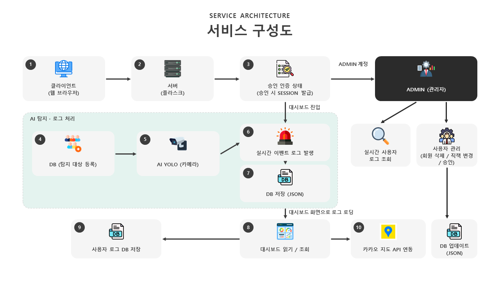

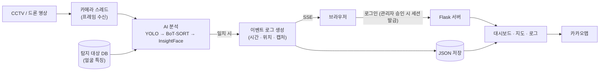

### 데이터 흐름

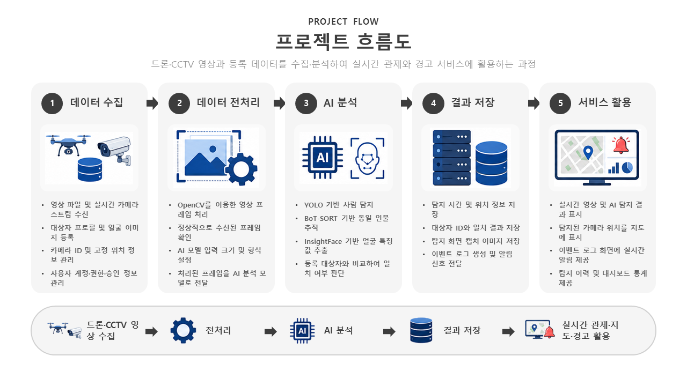

1. **수집**: 영상 파일·실시간 카메라 스트림 수신, 대상자 프로필·얼굴 이미지 등록
2. **전처리**: OpenCV로 프레임을 처리하고 모델 입력 크기에 맞춘다.
3. **분석**: 사람 탐지 → 동일 인물 추적 → 얼굴 특징 비교
4. **저장**: 탐지 시각·위치, 대상자 ID, 캡처 이미지, 이벤트 로그
5. **활용**: 실시간 영상·탐지 결과, 지도 표시, 이벤트 알림, 대시보드 통계

## 📁 폴더 구조

```text
obsidian-shield/
├─ main.py                  # 실행 진입점
├─ docs/
│  ├─ README.md             # 설치·실행 메모
│  ├─ requirements.txt      # 의존 패키지
│  └─ images/               # README 이미지
└─ app/
   ├─ app.py                # Flask 앱 생성, 블루프린트 등록
   ├─ configs.py            # 공통 키·상수 (로그인 실패 한도, 비밀번호 길이 등)
   ├─ domains/              # 도메인별 라우트·서비스·템플릿·정적 파일
   │  ├─ main/              # 로그인, 회원가입, 대시보드
   │  ├─ account/           # 회원 관리, 권한, 인증, CAPTCHA
   │  ├─ stream/            # 카메라, 탐지(YOLO)·추적·얼굴 식별, 탐지 대상 프로필
   │  ├─ logger/            # 이벤트 로그, 사용자 로그, 실시간 알림
   │  └─ map/               # 지도, 이동 경로
   ├─ utils/                # JSON 입출력, 페이지네이션, 정렬·필터 등 공통 도구
   ├─ jsons/                # 계정·카메라·이벤트·탐지 대상 데이터 (JSON)
   ├─ face_embeddings/      # 등록 얼굴 특징 벡터
   ├─ static/ · templates/  # 앱 전체가 공유하는 정적 파일·템플릿
```

## 🚀 로컬에서 실행하기

Python **3.12.0** 환경을 기준으로 한다.

```bash
git clone https://github.com/Kanabig/obsidian-shield.git
cd obsidian-shield

python -m venv .venv
.venv\Scripts\activate          # macOS/Linux: source .venv/bin/activate

pip install -r docs/requirements.txt
python main.py
```

- 서버는 `http://localhost:5000` 에서 열린다.
- 처음 실행할 때 YOLO·InsightFace 가중치를 내려받으므로 인터넷 연결이 필요하다.
- 카메라는 로그인 후 **카메라 관리**에서 카메라 ID, 영상 소스 주소(파일 경로 또는 스트림), 소스 타입을 등록해 쓴다.
- 지도는 카카오맵 JavaScript 키가 필요하다. 템플릿(`dashboard.html`, `map.html`)의 SDK 주소에 있는 `appkey` 를 본인 키로 바꾸고, 카카오 개발자 콘솔에 접속 도메인을 등록한다.

## 👥 팀

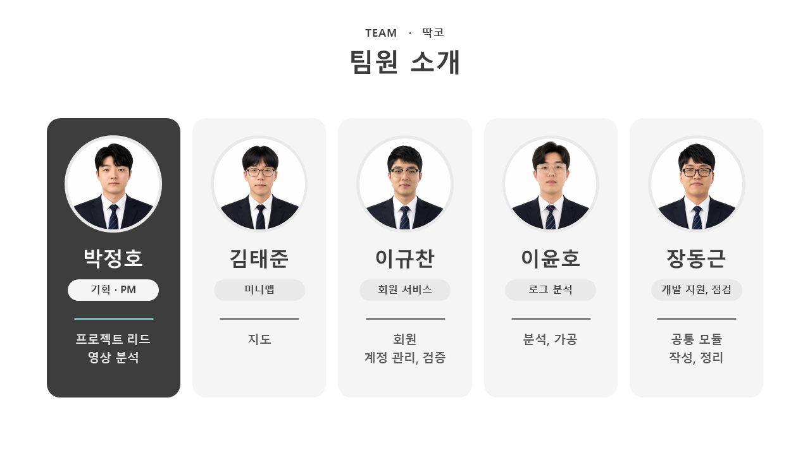

| 이름 | 역할 | 담당 | GitHub |
|---|---|---|---|
| 박정호 | 팀장(PM) | 기획·프로젝트 리드, AI 객체 탐지, 얼굴 인식(영상 분석) | [@Kanabig](https://github.com/Kanabig) |
| 이윤호 | 팀원 | 이벤트 로그·사용자 로그(탐지·열람 히스토리), 기획 발표자료 | [@ho8566z](https://github.com/ho8566z) |
| 이규찬 | 팀원 | 회원가입·회원 서비스(계정 관리, 검증) | [@guechanlee](https://github.com/guechanlee) |
| 장동근 | 팀원 | 회원 관리 시스템, UI 설계, 공통 모듈·점검 | [@j75390](https://github.com/j75390) |
| 김태준 | 팀원 | 미니맵·지도 | - |

## 🗓 진행 과정

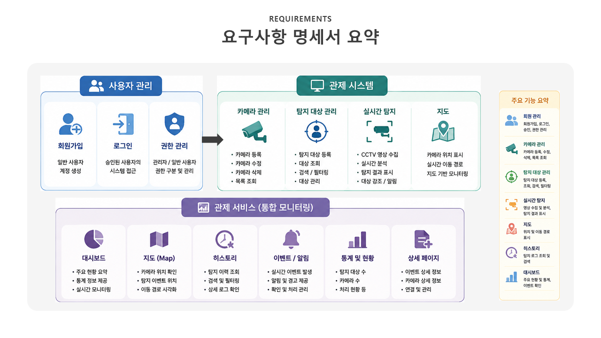

- 기간: 2026.06.25 ~ 2026.07.24 (4주)
- 기획·유사 서비스 분석 → 요구사항·기능 설계 → UI 설계 → 개발(회원, AI 탐지, 얼굴 인식, 미니맵, 히스토리, 통합 관제 화면) → 테스트·품질 개선 → 발표
- 브랜치는 `main`(배포) · `dev`(통합) · `feature/*`(기능)으로 나누어 협업했다.
- 산출물(요구사항 명세서, 기능 명세서, API 명세서, 개발 일정, 트러블슈팅)은 발표 자료와 함께 정리했다.

### API 요약

| 영역 | 엔드포인트 수 | 주요 내용 |
|---|---|---|
| Dashboard | 2 | 대시보드 구성, 실시간 갱신 |
| Event Log | 7 | 이벤트 조회·생성·수정·삭제, 실시간 알림(SSE), 엑셀 다운로드 |
| Stream | 4 | 실시간 영상 스트리밍, 카메라 CRUD, 탐지 프로필 관리 |
| Member | 7 | 회원 조회·등록·수정·삭제, 권한 수정 |
| User Log | 2 | 목록·상세 조회 |
| Map | 1 | 지도 정보, 탐지자 이동 경로·위치 |

## 🚧 알려진 한계와 개선 방향

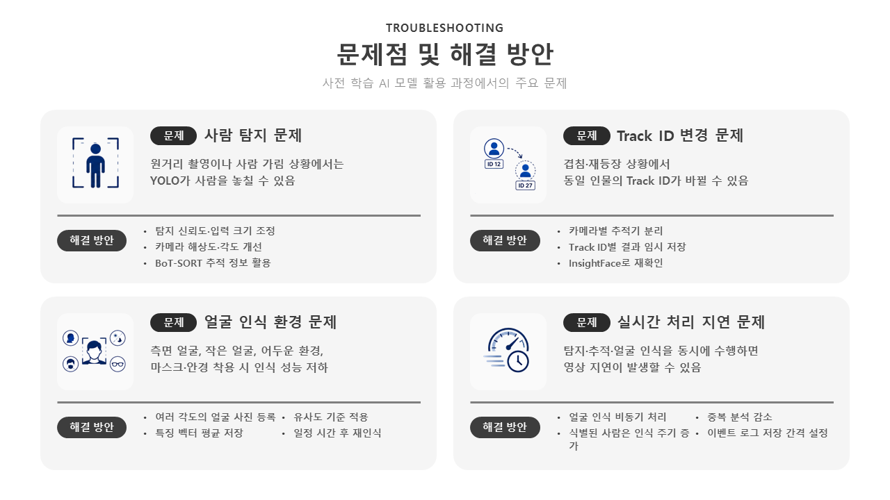

- 원거리 촬영이나 가림 상황에서는 YOLO가 사람을 놓칠 수 있다. 겹치거나 다시 나타나면 Track ID가 바뀔 수 있어, 카메라별 추적기 분리와 얼굴 재확인으로 보완했다.
- 측면·작은 얼굴, 어두운 환경, 마스크·안경에서는 얼굴 인식 성능이 떨어진다. 여러 각도의 사진을 등록하고 평균 특징을 쓰는 방식으로 완화했다.
- 탐지·추적·얼굴 인식을 함께 돌리면 영상 지연이 생길 수 있어, 얼굴 인식을 비동기로 처리하고 재인식 주기를 두었다.
- 데이터를 DB 대신 **JSON 파일**에 저장하므로 동시 접속·대용량에는 맞지 않는다.

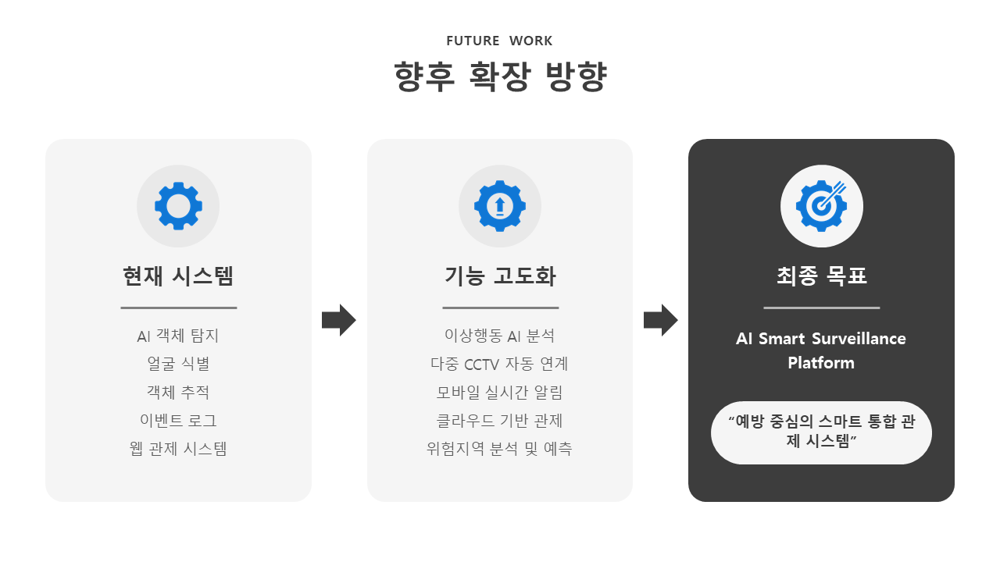

- 향후: 이상행동 AI 분석, 다중 CCTV 자동 연계, 모바일 실시간 알림, 클라우드 기반 관제, 위험지역 분석·예측
- 최종 목표: **예방 중심의 스마트 통합 관제 시스템**

<!-- TODO(사용자 확인): 얼굴 인식 모델(InsightFace buffalo_l)과 YOLO 가중치의 상업적 이용 라이선스는 확인하지 않았다. 팀에서 라이선스를 정하면 이 아래에 '라이선스' 절을 추가한다. -->
